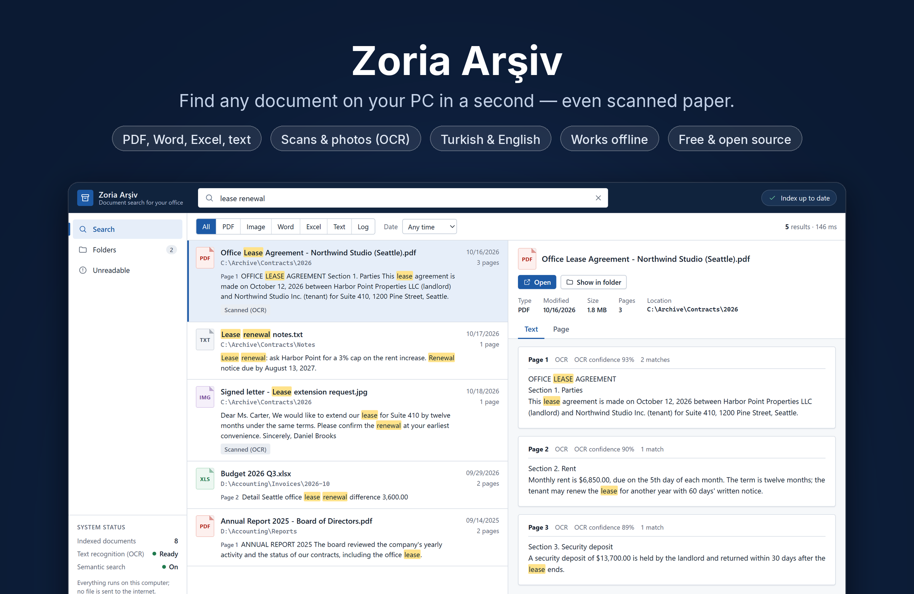
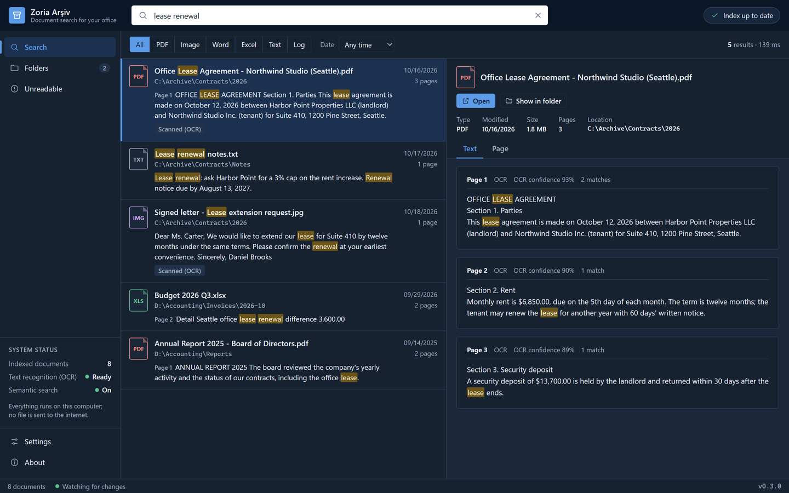
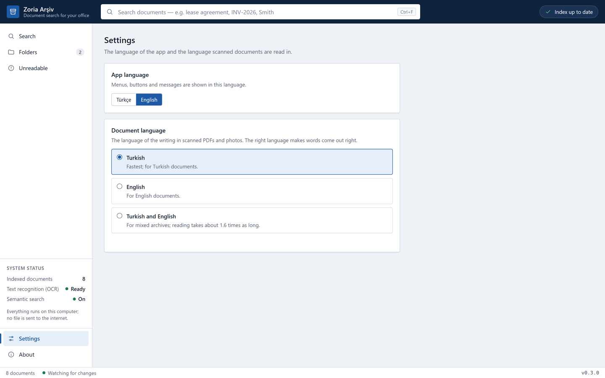

<p align="center">
  
</p>

<h1 align="center">Zoria Arşiv — local AI document search</h1>

<p align="center">
  <a href="https://github.com/ZoriaSoft/local-search-ai/releases/latest"></a>
  
  <a href="LICENSE"></a>
  
</p>

<p align="center">
  <a href="https://github.com/ZoriaSoft/local-search-ai/releases/latest"><b>Download for Windows</b></a> · <a href="README.tr.md">Türkçe</a>
</p>

Zoria Arşiv finds words inside the documents on your Windows PC: PDFs,
scanned papers and phone photos, Word, Excel and text files. Everything runs
offline on your computer. No file, index or search ever leaves it.

- **Full-text search** in PDF (text layer), Word (.docx), Excel (.xlsx/.xlsm),
  text, CSV, Markdown, JSON, XML and log files.
- **Scanned pages and photos** are read with bundled Tesseract OCR, in
  Turkish, English or both (Settings → Document language).
- **Semantic search**: a small on-device model (EmbeddingGemma 2, int4 ONNX)
  also finds pages that mean the same thing in other words.
- **Turkish-aware** matching: `sozlesme` finds `sözleşmesi`, inflected forms
  match their stem; English plurals and verb forms match too.
- **Watches your folders**: added, changed, moved and deleted files reach the
  index on their own.
- **Interface in Turkish and English**, following the Windows language.

Free and open source under the [Apache License 2.0](LICENSE).

## Screenshots

<table>
  <tr>
    <td width="50%"></td>
    <td width="50%"></td>
  </tr>
  <tr>
    <td align="center">Dark theme follows Windows</td>
    <td align="center">Interface and scan language in Settings</td>
  </tr>
</table>

## Download

Get the installer (`Zoria.Arsiv_<version>_x64-setup.exe`) from
[Releases](https://github.com/ZoriaSoft/local-search-ai/releases). Windows 10
or 11, 64-bit. The app needs no account and no internet connection.

## Privacy

Zoria Arşiv only reads your files; it never changes, moves or deletes them.
The index lives in `%APPDATA%\com.zoria.arsiv\index`; the uninstaller can
delete it. There is no telemetry, no analytics and no network call (automatic
updates stay off until a signed update channel exists).

## How it works

| Path | Role |
|---|---|
| `crates/arsiv-core` | extraction (PDFium, Tesseract, docx/xlsx/txt), SQLite catalog, Tantivy full-text index, vector index, folder watcher |
| `crates/arsiv-eval` | headless CLI: `index`, `search`, `lab` (replays a labelled query set) |
| `src/` | React + TypeScript interface (`src/i18n` holds every visible string, Turkish and English) |
| `src-tauri/` | Tauri 2 shell; IPC commands per `docs/API.md` |
| `resources/` | bundled binaries and data (see below), license notices |

Search combines BM25 over three views of each page (exact, ASCII-folded and
stemmed) with cosine similarity over page chunks, fused with reciprocal rank
fusion. Scanned pages go through PDFium rendering, optional deskew and
Tesseract (`--oem 1`, tessdata_best models).

## Building from source

Requirements: Windows 10/11 x64, Rust (stable, MSVC), Node.js 20+,
Git Bash (for the fetch script).

```bash
npm install
bash scripts/fetch-semantic-model.sh windows   # model + ONNX Runtime, sha256-pinned (~180 MB)
```

Binaries that are not in git, placed under `resources/`:

- `resources/pdfium/pdfium.dll` from
  [pdfium-binaries](https://github.com/bblanchon/pdfium-binaries) (chromium/8100).
- `resources/bin/` — `tesseract.exe` and its DLLs from the
  [UB Mannheim Windows build](https://github.com/UB-Mannheim/tesseract) (5.5.x).
- `resources/tessdata/` — `tur.traineddata` and `eng.traineddata` from
  [tessdata_best](https://github.com/tesseract-ocr/tessdata_best) (in git).

Then:

```bash
npm run tauri dev      # run with the real engine
npm run build:windows  # privacy-checked NSIS installer under target/release/bundle/nsis
```

Use `build:windows` for distributable Windows builds. It remaps the user
profile, Cargo home and checkout paths before compiling dependencies, then
rejects an executable that still contains a Windows user-profile path.

Without the model the app still works (keyword search only); without
Tesseract scanned pages are reported as unreadable.

UI only, with an in-browser mock backend:

```bash
npm run dev            # http://127.0.0.1:1420
```

## Tests

```bash
cargo test --release --workspace   # Rust (some tests need pdfium/tesseract; they skip when absent)
npm test                           # TypeScript unit tests
npx tsc -b                         # type check
```

Point the OCR tests at a Tesseract install with `ARSIV_TEST_TESSERACT` and
`ARSIV_TEST_TESSDATA`.

## Third-party components

The app bundles Tesseract OCR, PDFium, EmbeddingGemma 2, ONNX Runtime, Tauri
and many Rust and npm packages, each under its own license. The full list and
every license text are in
[`resources/licenses/THIRD_PARTY_NOTICES.txt`](resources/licenses/THIRD_PARTY_NOTICES.txt)
and on the app's About page. `scripts/gen-notices.py` regenerates them when a
dependency or a bundled binary changes.

## License

Copyright 2026 ZoriaSoft. Licensed under the [Apache License, Version 2.0](LICENSE).
The names "Zoria", "Zoria Arşiv" and "ZoriaSoft" and their logos are not
covered by the license. See also [`NOTICE`](NOTICE) and the
[terms of use](resources/licenses/TERMS.txt).
