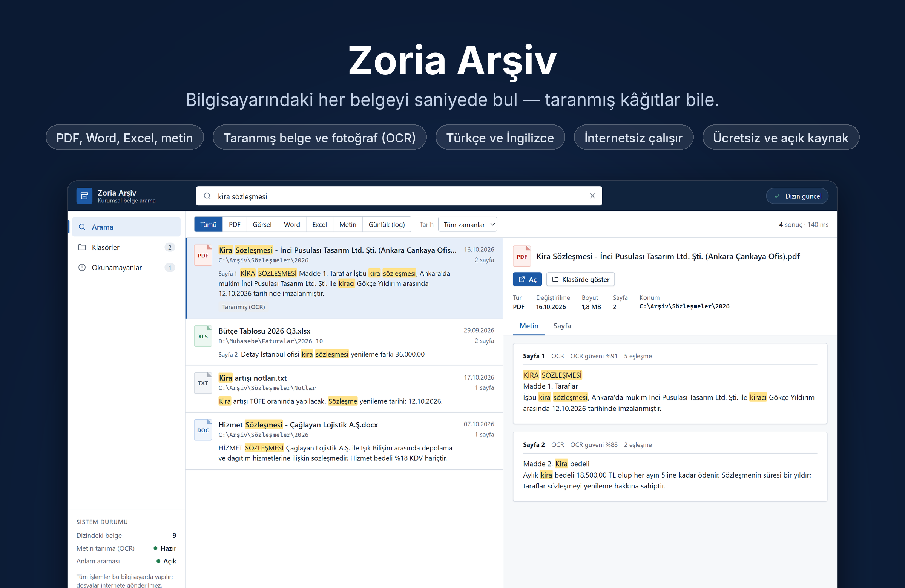

<p align="center">
  
</p>

<h1 align="center">Zoria Arşiv — yerel yapay zekâ destekli belge arama</h1>

<p align="center">
  <a href="https://github.com/ZoriaSoft/local-search-ai/releases/latest"></a>
  
  <a href="LICENSE"></a>
  
</p>

<p align="center">
  <a href="https://github.com/ZoriaSoft/local-search-ai/releases/latest"><b>Windows için indir</b></a> · <a href="README.md">English</a>
</p>

Zoria Arşiv, Windows bilgisayarınızdaki belgelerin içinde arama yapar: PDF'ler,
taranmış evrak ve telefon fotoğrafları, Word, Excel ve metin dosyaları. Her şey
bilgisayarınızda, internetsiz çalışır. Hiçbir dosya, dizin ya da arama dışarı
çıkmaz.

- **Tam metin arama**: PDF (metin katmanı), Word (.docx), Excel (.xlsx/.xlsm),
  metin, CSV, Markdown, JSON, XML ve log dosyaları.
- **Taranmış sayfalar ve fotoğraflar** pakete dahil Tesseract OCR ile okunur;
  Türkçe, İngilizce ya da ikisi birden (Ayarlar → Belge dili).
- **Anlam araması**: cihazda çalışan küçük bir model (EmbeddingGemma 2, int4
  ONNX) aynı şeyi başka kelimelerle anlatan sayfaları da bulur.
- **Türkçeye uygun eşleştirme**: `sozlesme` yazınca `sözleşmesi` bulunur, ekli
  hâller köküyle eşleşir; İngilizce çoğul ve fiil ekleri de tanınır.
- **Klasörleri izler**: eklenen, değişen, taşınan ve silinen dosyalar dizine
  kendiliğinden yansır.
- **Türkçe ve İngilizce arayüz**, Windows diline göre açılır.

Ücretsiz ve açık kaynak, [Apache Lisansı 2.0](LICENSE).

## Ekran görüntüleri

<table>
  <tr>
    <td width="50%"></td>
    <td width="50%"></td>
  </tr>
  <tr>
    <td align="center">Koyu tema Windows'u izler</td>
    <td align="center">Arayüz ve tarama dili Ayarlar'da</td>
  </tr>
</table>

## İndirme

Kurulum dosyasını (`Zoria.Arsiv_<sürüm>_x64-setup.exe`)
[Releases](https://github.com/ZoriaSoft/local-search-ai/releases) sayfasından
indirin. Windows 10 veya 11, 64 bit. Hesap ya da internet bağlantısı gerekmez.

## Gizlilik

Zoria Arşiv dosyalarınızı yalnızca okur; değiştirmez, taşımaz, silmez. Dizin
`%APPDATA%\com.zoria.arsiv\index` klasöründe durur ve kaldırma sırasında
silinebilir. Kullanım ölçümü, analiz ya da ağ bağlantısı yoktur.

## Kaynaktan derleme

Gereken: Windows 10/11 x64, Rust (stable, MSVC), Node.js 20+, Git Bash.

```bash
npm install
bash scripts/fetch-semantic-model.sh windows   # model + ONNX Runtime (~180 MB)
npm run build:windows                          # gizlilik kontrolünden geçen NSIS kurucusu
```

Dağıtılacak Windows kurucusunu `build:windows` ile üretin. Komut, kullanıcı
profili, Cargo ve kaynak klasörü yollarını derleme sırasında nötr yollarla
değiştirir; çalıştırılabilir dosyada Windows kullanıcı profili yolu kalırsa
hata verir.

Git'te olmayan ikili dosyalar (`resources/pdfium/pdfium.dll`, `resources/bin/`
altındaki Tesseract) ve testler için ayrıntılar [README.md](README.md)
dosyasındadır.

## Lisans

Telif hakkı 2026 ZoriaSoft. [Apache Lisansı 2.0](LICENSE) ile lisanslanmıştır.
"Zoria", "Zoria Arşiv" ve "ZoriaSoft" adları ile logoları lisansın kapsamında
değildir. Ayrıca bkz. [`NOTICE`](NOTICE) ve
[kullanım koşulları](resources/licenses/KULLANIM_KOSULLARI.txt). Üçüncü taraf
bileşenlerin listesi ve lisans metinleri
[`resources/licenses/THIRD_PARTY_NOTICES.txt`](resources/licenses/THIRD_PARTY_NOTICES.txt)
dosyasındadır.
